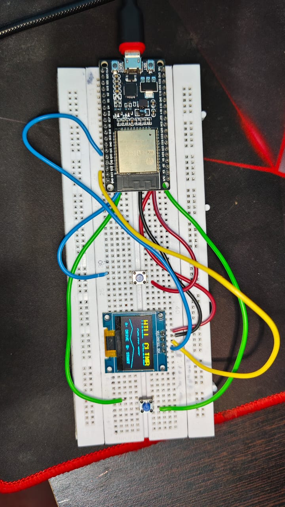

# 🎮 ESP32 Hill Climb Game

A Hill Climb Racing-inspired game built with an ESP32 DevKit and a 128×64 SSD1306 OLED display.

## 🧰 Hardware
- ESP32 38-pin DevKit
- SSD1306 128×64 I2C OLED
- Two push buttons
- Jumper wires and USB cable

## 🔌 Wiring

| Component | ESP32 pin |
|---|---|
| OLED VCC | 3.3V |
| OLED GND | GND |
| OLED SDA | GPIO 21 |
| OLED SCL | GPIO 22 |
| Button A | GPIO 25 to GND |
| Button B | GPIO 26 to GND |

Button connections assume the sketch uses `INPUT_PULLUP`.

## ✨ Features

See the source code for the implemented gameplay, controls, levels, obstacles, and animations.

## 💻 Requirements
- Arduino IDE
- ESP32 board support package
- Adafruit GFX Library
- Adafruit SSD1306 Library

## 🚀 How to Upload

1. Download `hillclimbonesp32.ino` from this repository.
2. Install the required libraries in Arduino IDE.
3. Select **ESP32 Dev Module** under Tools → Board.
4. Connect the OLED and buttons.
5. Select the correct serial port.
6. Compile and upload the sketch.

## 📸 Project Photo

## 🤝 Contributions

Suggestions, bug reports, and improvements are welcome.

## 📄 License

See the included MIT `LICENSE` file for license terms.
